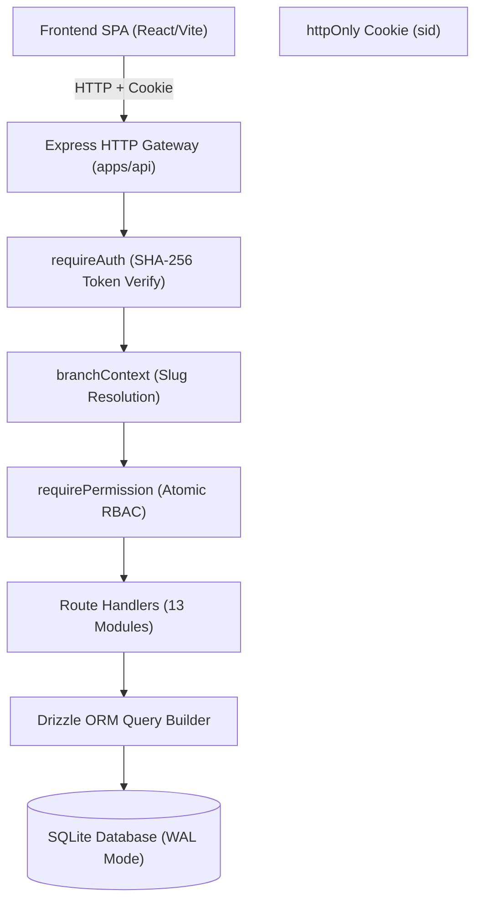

# 01. Current State Assessment

## 1. Executive Summary
This document provides an exhaustive architectural, operational, and code-level audit of the existing Hospital Management System (HMS) backend prior to restructuring and migrating to Python (FastAPI). The current backend is a TypeScript/Node.js service utilizing Express, Drizzle ORM, and SQLite.

---

## 2. Existing Architecture & Tech Stack



### 2.1 Workspace Structure
The project is organized as an npm/pnpm monorepo:
- `apps/api`: Express.js backend listening on `:3001` (`apps/api/src/app.ts`, `apps/api/src/index.ts`).
- `apps/web`: React/Vite single-page application communicating over `/api/*`.
- `packages/core`: Core domain logic, security primitives, authentication, branch context, and Drizzle SQLite schema definitions.
- `packages/shared`: Shared Zod validation schemas, permission definitions (`ALL_PERMISSIONS`), role definitions, and calculation helpers.
- `packages/ui`: Shared React components (Tailwind CSS, Radix UI).
- `sql/`: Authoritative 68-table PostgreSQL DDL distribution (`global`, `master`, `public`, `staging`) incorporating organizational hierarchy and GST audit requirements.

### 2.2 Core Dependencies
- **Runtime**: Node.js v20+ with ES Modules.
- **HTTP Framework**: Express v4.
- **ORM / Persistence**: Drizzle ORM (`drizzle-orm/better-sqlite3`).
- **Validation**: Zod schemas shared across frontend and backend.
- **Security Primitives**: Node.js `crypto` (PBKDF2 with SHA-512, 100,000 iterations for passwords; SHA-256 for session token lookup hashes).

---

## 3. Current Endpoint Inventory

Branch-scoped operations reside under `/api/b/:branch/*`. Platform operations reside under `/api/platform/*`. Identity operations reside under `/api/auth/*`.

| Route Prefix | Source File | Responsibilities | Auth / Permission |
| :--- | :--- | :--- | :--- |
| `/api/auth` | `apps/api/src/routes/platform.ts` | Login, logout, session verification (`/me`), password changes | Cookie Auth (`sid`) |
| `/api/platform` | `apps/api/src/routes/platform.ts` | Hospital registration, clinic branches, platform users, billing tiers | Platform Admin / Owner |
| `/api/b/:branch/patients` | `apps/api/src/routes/patients.ts` | Patient registration, UHID generation, search, profile, medical timeline | `patient.read`, `patient.create`, `patient.update` |
| `/api/b/:branch/visits` | `apps/api/src/routes/visits.ts` | Token issuance, vitals recording, clinical notes, prescriptions, status transitions | `op_visit.read`, `op_visit.create`, `clinical.write` |
| `/api/b/:branch/doctors` | `apps/api/src/routes/doctors.ts` | Branch doctor assignments, OPD consultation fee tiers, active rosters | `admin.manage_users` |
| `/api/b/:branch/treatments`| `apps/api/src/routes/treatments.ts`| Treatment dose records, procedural injections, nurse administration | `treatment.administer` |
| `/api/b/:branch/bookmarks` | `apps/api/src/routes/bookmarks.ts` | Doctor prescription favorites and treatment dosage shortcuts | `prescription.write` |
| `/api/b/:branch/courses` | `apps/api/src/routes/courses.ts` | Multi-sitting treatment packages, session tracking, course items | `course.manage` |
| `/api/b/:branch/lab` | `apps/api/src/routes/lab.ts` | Lab orders, parameter measurements, abnormal flags, doctor validation, emergency print release | `lab.order`, `lab.entry`, `lab.release` |
| `/api/b/:branch/pharmacy` | `apps/api/src/routes/pharmacy.ts` | Formulary catalog, FEFO stock batches, retail/OTC sales, dispense | `pharmacy.read`, `pharmacy.dispense` |
| `/api/b/:branch/billing` | `apps/api/src/routes/billing.ts` | Consolidated invoicing, line items, payments, receipts, cancellations | `billing.invoice.create`, `billing.payment` |
| `/api/b/:branch/checkout`| `apps/api/src/routes/checkout.ts`| Atomic OPD consultation + pharmacy checkout transaction | `billing.invoice.create` |
| `/api/b/:branch/vendors` | `apps/api/src/routes/vendors.ts` | Drug suppliers, purchase bills, vendor payments, clinic expenses | `inventory.manage`, `billing.expense` |
| `/api/b/:branch/backup` | `apps/api/src/routes/backup.ts` | SQLite database snapshot download and point-in-time restore | `platform.admin` |

---

## 4. Database Usage Inventory

### 4.1 Schema Characteristics
- The existing system uses SQLite with `journal_mode = WAL` and `foreign_keys = ON`.
- Business models enforce strict tenant separation through a mandatory `branch_id` column on operational records.
- Soft-delete semantics (`deleted_at IS NULL`) are ubiquitous.
- Monetary figures are stored strictly as integer **paise** (`BIGINT` or `INTEGER`).

### 4.2 Limitations of Existing SQLite Setup
1. **Concurrency**: Write transactions acquire an exclusive file lock (`BEGIN IMMEDIATE`), creating bottlenecks under high concurrency.
2. **Type Affinity**: SQLite lacks native date/timestamp, UUID, and decimal types.
3. **No Named Schemas**: Everything exists in a single namespace.
4. **Limited Constraint Enforcement**: Composite foreign key constraints referencing multiple unique columns across schemas are unsupported in SQLite.

---

## 5. Authentication and Authorization Flow

```text
Incoming Request -> Cookie: sid=<random_64_char_hex>
  -> Compute SHA-256(sid) -> Query sessions WHERE token_hash = ? AND expires_at > NOW()
  -> Fetch User + User Roles
  -> If route has :branch -> Resolve branch by slug -> Verify user belongs to branch's organization
  -> Verify required permission -> If granted: Proceed; If denied: Return 403 Forbidden
```

### Key Security Invariants
- Sessions are stored only as a **SHA-256 hash** of the raw cookie token.
- Raw session tokens are never sent in response bodies or stored in `localStorage`.
- Branch isolation guarantees that an entity from another branch returns `404 Not Found`, never `403 Forbidden` (preventing branch enumeration).

---

## 6. Identified Risks & Non-Negotiable Preserved Behaviors

1. **API Error Contract**: Every error must match `{ error: string, code: string, fields?: Record<string, string[]> }`. No raw tracebacks may be sent to clients.
2. **Deterministic Financial Computations**: All currency values must remain in whole paise with standard round-off logic.
3. **Audit Immutability**: All creates, updates, and deletes must append to `audit_logs`.
4. **FEFO Inventory Allocation**: Dispensary stock allocation must strictly prioritize First-Expiry-First-Out (`ORDER BY expiry_date ASC, id ASC`).
5. **No Breaking Frontend Changes**: The React frontend must continue functioning without modification by matching the existing URL routes, cookie authentication, and JSON schemas.

