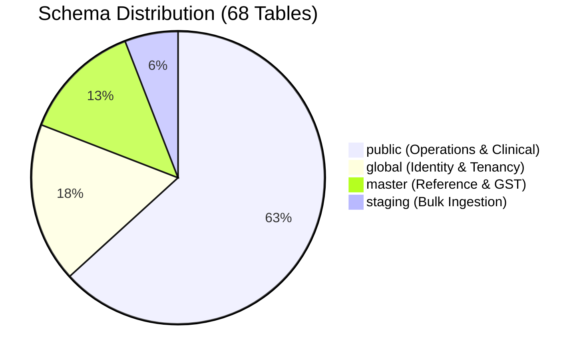

# 03. Database Model Inventory

## 1. Inventory Summary

This catalog documents all **68 tables** defined in the authoritative SQL specification under [`sql/`](file:///c:/Users/smani/OneDrive/Desktop/git/hospital-management-CRM/sql). Each table is mapped to its canonical SQLAlchemy ORM model under `src/models/` and its corresponding repository under `src/repository/`.

---

## 2. Global Schema (`global`) — 12 Tables

| Physical Table Name | Primary Key | Key Foreign Keys | Key Columns | ORM Model Path | Repository Path | SQLite Notes |
| :--- | :--- | :--- | :--- | :--- | :--- | :--- |
| `organizations` | `id BIGINT` | None | `name`, `slug`, `billing_tier`, `is_active` | `src/models/global_schema/organizations.py` | `src/repository/organization_repository.py` | Renamed to `global_organizations` on SQLite |
| `organization_plans` | `id BIGINT` | `company_id -> organizations(id)` | `plan_code`, `max_branches`, `max_users` | `src/models/global_schema/organization_plans.py` | `src/repository/organization_repository.py` | JSONB stored as TEXT |
| `platform_payments` | `id BIGINT` | `company_id -> organizations(id)` | `amount_paise`, `gateway_ref`, `status` | `src/models/global_schema/platform_payments.py` | `src/repository/platform_payment_repository.py` | Integer paise |
| `org_counters` | `company_id, name` | `company_id -> organizations(id)` | `value BIGINT` | `src/models/global_schema/org_counters.py` | `src/repository/counter_repository.py` | Atomic upsert via ON CONFLICT |
| `users` | `id BIGINT` | None | `email (citext)`, `password_hash`, `role` | `src/models/global_schema/users.py` | `src/repository/user_repository.py` | `citext` mapped to `COLLATE NOCASE` |
| `sessions` | `id BIGINT` | `user_id -> users(id)` | `token_hash (CHAR 64)`, `expires_at` | `src/models/global_schema/sessions.py` | `src/repository/session_repository.py` | ISO-8601 strings for timestamps |
| `permissions` | `id BIGINT` | None | `key VARCHAR(80)`, `module`, `action` | `src/models/global_schema/permissions.py` | `src/repository/permission_repository.py` | Seeded via master migration |
| `roles` | `id BIGINT` | `company_id -> organizations(id)` | `name`, `code`, `is_system` | `src/models/global_schema/roles.py` | `src/repository/role_repository.py` | System roles have NULL company_id |
| `role_permissions` | `role_id, permission_id` | `role_id -> roles(id)`, `permission_id -> permissions(id)` | None | `src/models/global_schema/role_permissions.py` | `src/repository/role_repository.py` | Composite PK |
| `organization_memberships` | `id BIGINT` | `company_id -> organizations(id)`, `user_id -> users(id)` | `is_owner`, `is_active`, `joined_at` | `src/models/global_schema/organization_memberships.py` | `src/repository/organization_repository.py` | Unique `(company_id, user_id)` |
| `user_roles` | `id BIGINT` | `user_id -> users(id)`, `role_id -> roles(id)` | `company_id`, `branch_id`, `region_id`, `inventory_id` | `src/models/global_schema/user_roles.py` | `src/repository/user_role_repository.py` | Scoped indexes on `(company_id, region_id)` |
| `user_permission_overrides` | `id BIGINT` | `user_id -> users(id)`, `permission_id -> permissions(id)`| `company_id`, `is_granted`, `reason` | `src/models/global_schema/user_permission_overrides.py` | `src/repository/user_override_repository.py` | Scoped indexes on `(company_id, region_id)` |

---

## 3. Master Schema (`master`) — 9 Tables

| Physical Table Name | Primary Key | Key Foreign Keys | Key Columns | ORM Model Path | Repository Path | SQLite Notes |
| :--- | :--- | :--- | :--- | :--- | :--- | :--- |
| `countries` | `code VARCHAR(2)` | None | `name`, `iso3`, `phone_code` | `src/models/master/countries.py` | `src/repository/master_repository.py` | Master ISO data |
| `states` | `code VARCHAR(10)` | `country_code -> countries(code)`| `name`, `gst_state_code (CHAR 2)` | `src/models/master/states.py` | `src/repository/master_repository.py` | Place of supply validation |
| `uom_codes` | `code VARCHAR(15)` | None | `name`, `category` (count, volume, mass) | `src/models/master/uom_codes.py` | `src/repository/master_repository.py` | Formulary units |
| `payment_methods` | `code VARCHAR(20)` | None | `name`, `requires_ref`, `is_active` | `src/models/master/payment_methods.py` | `src/repository/master_repository.py` | Cash, Card, UPI, etc. |
| `hsn_sac_codes` | `code VARCHAR(10)` | None | `type` (hsn/sac), `description` | `src/models/master/hsn_sac_codes.py` | `src/repository/master_repository.py` | Statutory GST classification |
| `gst_tax_codes` | `code VARCHAR(20)` | None | `name`, `is_nil_rated`, `is_exempt` | `src/models/master/gst_tax_codes.py` | `src/repository/master_repository.py` | Tax category master |
| `gst_rates` | `id BIGINT` | `tax_code -> gst_tax_codes(code)`| `cgst_rate`, `sgst_rate`, `igst_rate`, `valid_from` | `src/models/master/gst_rates.py` | `src/repository/master_repository.py` | Numeric decimal rates |
| `lab_catalog` | `code VARCHAR(30)` | None | `name`, `specimen`, `turnaround_hours` | `src/models/master/lab_catalog.py` | `src/repository/master_repository.py` | Reference test catalog |
| `lab_parameters` | `id BIGINT` | `test_code -> lab_catalog(code)`| `name`, `unit`, `ref_min`, `ref_max` | `src/models/master/lab_parameters.py` | `src/repository/master_repository.py` | Numeric/text thresholds |

---

## 4. Public Schema (`public`) — Operations & Clinical (43 Tables)

| Physical Table Name | Key Foreign Keys | Key Columns | ORM Model Path | Repository Path | SQLite Notes |
| :--- | :--- | :--- | :--- | :--- | :--- |
| `regions` | `company_id -> organizations(id)` | `code`, `name`, `is_active` | `src/models/public/regions.py` | `src/repository/region_repository.py` | Unique `(id, company_id)` |
| `inventory_locations` | `company_id -> organizations(id)` | `code`, `name`, `type`, `address` | `src/models/public/inventory_locations.py` | `src/repository/inventory_repository.py` | Unique `(id, company_id)` |
| `region_inventory` | `region_id -> regions(id)`, `inventory_id -> inventory_locations(id)` | `company_id`, `is_active` | `src/models/public/region_inventory.py` | `src/repository/region_inventory_repository.py` | M:N Junction, Composite FKs |
| `branches` | `company_id -> organizations(id)`, `region_id -> regions(id)` | `slug`, `name`, `gstin`, `code_prefix` | `src/models/public/branches.py` | `src/repository/branch_repository.py` | Branch isolation root |
| `branch_doctors` | `branch_id -> branches(id)`, `user_id -> users(id)` | `consultation_fee_paise`, `is_active`| `src/models/public/branch_doctors.py` | `src/repository/doctor_repository.py` | Roster and fee rates |
| `branch_counters` | `branch_id -> branches(id)` | `name`, `value` | `src/models/public/branch_counters.py` | `src/repository/counter_repository.py` | Token/bill sequencing |
| `clinic_settings` | `branch_id -> branches(id)` | `key`, `value` (JSONB) | `src/models/public/clinic_settings.py` | `src/repository/clinic_setting_repository.py` | Branch configuration |
| `patients` | `company_id`, `branch_id` | `uhid`, `name`, `phone`, `gender`, `dob` | `src/models/public/patients.py` | `src/repository/patient_repository.py` | Universal Hospital ID |
| `op_visits` | `patient_id`, `doctor_id`, `branch_id` | `token_no`, `status`, `bp_systolic`, `notes` | `src/models/public/op_visits.py` | `src/repository/visit_repository.py` | Outpatient consultation |
| `prescription_items`| `visit_id -> op_visits(id)` | `drug_name`, `dosage`, `frequency`, `duration` | `src/models/public/prescription_items.py` | `src/repository/prescription_repository.py` | Rx medication lines |
| `prescription_notes`| `visit_id -> op_visits(id)` | `notes`, `created_by` | `src/models/public/prescription_notes.py` | `src/repository/prescription_repository.py` | Free-text clinical narrative |
| `treatment_doses` | `visit_id -> op_visits(id)` | `medicine_name`, `dose`, `route`, `administered_at` | `src/models/public/treatment_doses.py` | `src/repository/treatment_repository.py` | Nurse injection records |
| `treatment_bookmarks`| `branch_id -> branches(id)` | `title`, `doctor_id` | `src/models/public/treatment_bookmarks.py` | `src/repository/bookmark_repository.py` | Prescription templates |
| `treatment_bookmark_lines`| `bookmark_id -> treatment_bookmarks(id)`| `medicine_name`, `dosage`, `frequency` | `src/models/public/treatment_bookmark_lines.py` | `src/repository/bookmark_repository.py` | Template drug lines |
| `visit_instructions`| `visit_id -> op_visits(id)` | `instruction`, `is_custom` | `src/models/public/visit_instructions.py` | `src/repository/visit_repository.py` | Patient discharge advice |
| `treatment_courses`| `patient_id`, `branch_id` | `name`, `total_sittings`, `completed_sittings`| `src/models/public/treatment_courses.py` | `src/repository/course_repository.py` | Multi-sitting package |
| `course_sittings` | `course_id -> treatment_courses(id)` | `sitting_no`, `status`, `notes` | `src/models/public/course_sittings.py` | `src/repository/course_repository.py` | Session execution |
| `course_items` | `sitting_id -> course_sittings(id)` | `item_name`, `quantity`, `performed_by` | `src/models/public/course_items.py` | `src/repository/course_repository.py` | Consumables / procedures |
| `course_templates`| `branch_id -> branches(id)` | `title`, `total_sittings`, `default_fee_paise`| `src/models/public/course_templates.py` | `src/repository/course_repository.py` | Course archetype master |
| `lab_tests` | `branch_id -> branches(id)` | `code`, `name`, `price_paise`, `specimen` | `src/models/public/lab_tests.py` | `src/repository/lab_repository.py` | Branch diagnostic tests |
| `lab_test_parameters`| `test_id -> lab_tests(id)` | `name`, `unit`, `ref_min`, `ref_max` | `src/models/public/lab_test_parameters.py`| `src/repository/lab_repository.py` | Test analytes |
| `lab_packages` | `branch_id -> branches(id)` | `name`, `price_paise`, `test_ids` (JSONB) | `src/models/public/lab_packages.py` | `src/repository/lab_repository.py` | Bundled test panels |
| `lab_orders` | `visit_id -> op_visits(id)` | `order_no`, `status`, `specimen_collected_at` | `src/models/public/lab_orders.py` | `src/repository/lab_repository.py` | Diagnostic work orders |
| `lab_results` | `order_id -> lab_orders(id)` | `parameter_id`, `value`, `is_abnormal` | `src/models/public/lab_results.py` | `src/repository/lab_repository.py` | Analyte values |
| `lab_releases` | `visit_id -> op_visits(id)` | `released_by`, `reason`, `released_at` | `src/models/public/lab_releases.py` | `src/repository/lab_repository.py` | Emergency print releases |
| `medicines` | `branch_id -> branches(id)` | `name`, `form`, `strength`, `price_paise` | `src/models/public/medicines.py` | `src/repository/medicine_repository.py` | Branch formulary |
| `inventory_batches`| `inventory_id`, `medicine_id` | `batch_no`, `expiry_date`, `quantity` | `src/models/public/inventory_batches.py` | `src/repository/inventory_batch_repository.py`| FEFO lot tracking |
| `inventory_movements`| `inventory_id`, `medicine_id` | `movement_type`, `quantity_delta`, `balance_after`| `src/models/public/inventory_movements.py`| `src/repository/inventory_movement_repository.py`| Immutable ledger |
| `pharmacy_sales` | `branch_id`, `inventory_id` | `sale_no`, `total_paise`, `payment_mode` | `src/models/public/pharmacy_sales.py` | `src/repository/pharmacy_repository.py` | POS sales transactions |
| `pharmacy_sale_lines`| `sale_id -> pharmacy_sales(id)` | `medicine_id`, `batch_id`, `quantity`, `price`| `src/models/public/pharmacy_sale_lines.py`| `src/repository/pharmacy_repository.py` | FEFO allocated units |
| `vendors` | `branch_id -> branches(id)` | `name`, `gstin`, `phone`, `state_code` | `src/models/public/vendors.py` | `src/repository/vendor_repository.py` | Drug distributors |
| `purchase_invoices`| `vendor_id`, `inventory_id` | `vendor_invoice_no`, `taxable_amount_paise` | `src/models/public/purchase_invoices.py` | `src/repository/purchase_invoice_repository.py`| Inward stock bills |
| `purchase_invoice_lines`| `invoice_id -> purchase_invoices(id)`| `medicine_id`, `batch_no`, `mrp_paise`, `qty` | `src/models/public/purchase_invoice_lines.py`| `src/repository/purchase_invoice_repository.py`| Pack & free units |
| `purchase_invoice_tax_lines`| `line_id -> purchase_invoice_lines(id)`| `tax_code`, `cgst_paise`, `sgst_paise`, `igst_paise`| `src/models/public/purchase_invoice_tax_lines.py`| `src/repository/purchase_invoice_repository.py`| Frozen GST snapshot |
| `vendor_payments` | `invoice_id -> purchase_invoices(id)` | `amount_paise`, `payment_method`, `ref_no` | `src/models/public/vendor_payments.py` | `src/repository/vendor_repository.py` | Supplier remittances |
| `expenses` | `branch_id -> branches(id)` | `category`, `amount_paise`, `payment_mode` | `src/models/public/expenses.py` | `src/repository/expense_repository.py` | Clinic expenditures |
| `invoices` | `branch_id -> branches(id)` | `invoice_no`, `total_paise`, `status` | `src/models/public/invoices.py` | `src/repository/billing_repository.py` | Finalized patient bills |
| `invoice_lines` | `invoice_id -> invoices(id)` | `item_type`, `description`, `amount_paise` | `src/models/public/invoice_lines.py` | `src/repository/billing_repository.py` | Procedural & Rx items |
| `invoice_tax_lines`| `line_id -> invoice_lines(id)` | `hsn_sac_code`, `cgst_paise`, `sgst_paise` | `src/models/public/invoice_tax_lines.py` | `src/repository/billing_repository.py` | Frozen GST component |
| `invoice_payments`| `invoice_id -> invoices(id)` | `receipt_no`, `amount_paise`, `payment_method` | `src/models/public/invoice_payments.py` | `src/repository/billing_repository.py` | Cashier receipts |
| `credit_debit_notes`| `original_invoice_id -> invoices(id)`| `note_type`, `amount_paise`, `reason`, `gstin` | `src/models/public/credit_debit_notes.py` | `src/repository/billing_repository.py` | Statutory GST adjustments |
| `visit_charges` | `visit_id -> op_visits(id)` | `charge_type`, `amount_paise`, `is_billed` | `src/models/public/visit_charges.py` | `src/repository/visit_repository.py` | Staged billable charges |
| `audit_logs` | `branch_id -> branches(id)` | `action`, `entity_type`, `entity_id`, `diff` | `src/models/public/audit_logs.py` | `src/repository/audit_repository.py` | Immutable audit trail |

---

## 5. Staging Schema (`staging`) — 4 Tables

| Physical Table Name | Key Foreign Keys | Key Columns | ORM Model Path | Repository Path | SQLite Notes |
| :--- | :--- | :--- | :--- | :--- | :--- |
| `inventory_import_batches`| `company_id`, `inventory_id` | `filename`, `status`, `total_rows`, `valid_rows` | `src/models/staging/inventory_imports.py` | `src/repository/staging_repository.py` | Pre-validation batch |
| `inventory_import_rows` | `batch_id -> inventory_import_batches(id)` | `row_number`, `raw_payload`, `error_message` | `src/models/staging/inventory_imports.py` | `src/repository/staging_repository.py` | Row quarantine |
| `vendor_invoice_imports` | `company_id`, `branch_id` | `filename`, `status`, `vendor_name` | `src/models/staging/vendor_invoice_imports.py`| `src/repository/staging_repository.py` | Inward bill batch |
| `vendor_invoice_import_rows`| `import_id -> vendor_invoice_imports(id)` | `medicine_name`, `batch_no`, `expiry`, `cost` | `src/models/staging/vendor_invoice_imports.py`| `src/repository/staging_repository.py` | CSV row parser |

