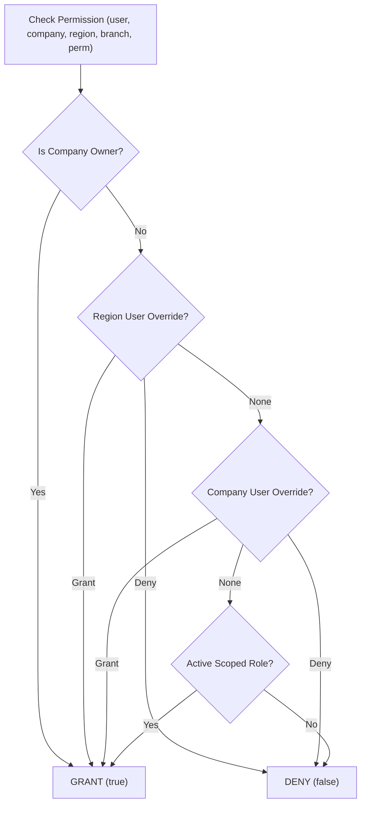

# 06. Authentication, Authorization & Multi-Tenant Security

## 1. Authentication Architecture

```text
HTTP Request
  └─ Header: Cookie: sid=<64-char-hex>
       │
       ▼
  [FastAPI Dependency: get_current_user]
       │
       ├─ Compute SHA-256(sid) -> hex string
       ├─ Query DAL: SELECT * FROM sessions WHERE token_hash = :hash AND expires_at > NOW()
       │    └─ If not found / expired -> raise HTTPException(401, "UNAUTHORIZED")
       │
       └─ Query DAL: SELECT * FROM users WHERE id = session.user_id AND deleted_at IS NULL
            └─ Attaches AuthenticatedPrincipal to RequestContext
```

### 1.1 Password Security
- Standard PBKDF2-HMAC-SHA512 algorithm with 100,000 iterations and 16-byte cryptographically random salt.
- Verifiable against legacy hashes generated by Node.js `crypto.pbkdf2Sync(password, salt, 100000, 64, 'sha512')`.

---

## 2. Multi-Tenant Branch Context & Isolation

When an endpoint contains the path parameter `branch_slug` (`/api/b/{branch_slug}/*`):
1. **Branch Resolution**:
   - `SELECT * FROM branches WHERE slug = :branch_slug AND is_active = true`
   - If not found $\rightarrow$ `404 Not Found`.
2. **Tenant Membership Verification**:
   - Verify that the authenticated user holds an active membership (`organization_memberships`) for `branch.company_id`.
   - If user does not belong to the company $\rightarrow$ `404 Not Found` (strict prevention of facility enumeration).

---

## 3. Generic Fine-Grained Authorization Engine

Authorization resolves permissions dynamically adhering to strict precedence:



$$\mathbf{Precedence}: \text{Company Owner} > \text{Explicit Deny} > \text{Explicit Grant} > \text{Scoped Role} > \text{Company Role}$$

### Authorization Implementation
In FastAPI, endpoints declare dependencies such as:
```python
@router.post("/patients", response_model=PatientDTO)
async def create_patient(
    payload: PatientCreateDTO,
    context: BranchContext = Depends(require_permission(Permissions.PATIENT_CREATE)),
    patient_service: PatientService = Depends(get_patient_service)
):
    return await patient_service.create_patient(context, payload)
```
This guarantees that permissions are enforced before any business logic executes.

